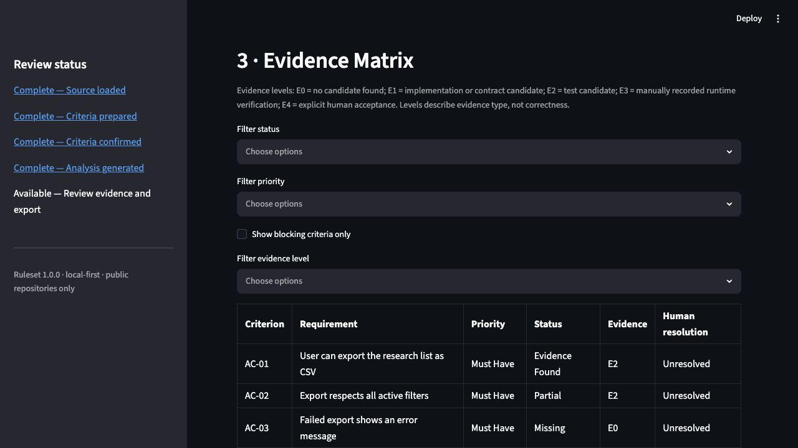

# ScopeProof

**See which acceptance criteria have credible PR evidence—and which still need review.**

**Start here:** [Choose a version and follow one short evaluation workflow](docs/evaluation-guide.md).
It separates the published v0.2.5 download from development source and the older private candidate,
then shows how to inspect, save and hand off a constructed review.

ScopeProof is a reviewer-controlled acceptance-coverage assistant for public GitHub pull requests.
The primary-operator hypothesis is an engineer or technical QA reviewer, with a PM or requirements
owner receiving the report; these roles remain unvalidated. It maps each confirmed criterion to
inspectable implementation or test candidates, makes missing evidence visible, records attributable
human decisions, and exports a reproducible review. The
primary workflow has a product target of reaching an inspectable coverage report in under five
minutes. That target has not yet been independently observed. The former Stage 1 under-ten-minute
target closed unmet when the owner chose not to pursue Stage 1.

ScopeProof is an evidence assistant. It does not replace QA, engineering review, runtime testing, or human acceptance.

The product direction is to **explain and revisit an acceptance decision**: retain the confirmed
intent, reviewed head, evidence gaps and recorded decisions as work changes. The
[November 2 product and market review](docs/commercialization/product-direction-2026-11-02.md) finds
substantial overlap elsewhere; this direction is a usefulness hypothesis, not a novelty claim.

Readable Markdown and HTML reports retain the saved review's decision audit: recorded actors,
times, event IDs, criteria revisions and Current/Superseded/Prior revision status, with explicit
evidence claims and runtime references. Analysis-only exports disclose unavailable full history.
These are recorded assertions, not authenticated approval or runtime proof. See the
[bounded handoff assessment](docs/audits/2026-11-01-readable-resolution-audit.md).
The workbench now uses the same target-based field projection. Mixed legacy decision/final-flag
fields remain visible with extra fields explicitly marked as not applied to that target, and
recorded offsets or missing timezones remain explicit. See the
[workbench consistency assessment](docs/audits/2026-11-01-workbench-resolution-audit.md).

Current direction: develop the reviewer workflow through a short, outcome-driven Stage 2 roadmap.
The published evaluation download is **v0.2.5**. Its wheel, source archive, and checksums
were verified after publication. Current development uses **0.2.6.dev0**. Stage 1 closed with all
external counts at zero, and Stage 3 remains dormant pending independent use. See the
[v0.2.5 verification record](docs/releases/v0.2.5-public-verification.md).
See the [public roadmap](ROADMAP.md#stage-2--owner-led-productization) for outcomes and limits and
[official-source market comparison](docs/commercialization/product-direction-2026-11-02.md) for
substantial competing workflows and the remaining value hypothesis.

The [R-001 Microsoft public-PR research record](docs/research/r001-microsoft-hve-core/summary.md)
shows a compact, hash-bound engineering rerun: observed CI and static candidates remain distinct
from runtime verification and human acceptance. It is public engineering research only and does
not advance Stage 1.

The [R-002 SWE-bench Verified static engineering benchmark](docs/research/r002-swebench-verified/summary.md)
adds a frozen 20-case, 12-repository deterministic baseline for candidate matching and immutable
references. It executes no target code and contributes zero Stage 1 validation credit.



*Controlled demo screenshot—not a customer case. It shows deterministic candidate evidence and
missing-evidence states; it is not runtime verification or proof of correctness. See the
[deliberately constructed demo](#deliberately-constructed-demo) for the expected findings.*

## Why this exists

AI coding agents can produce pull requests quickly, but a green CI check does not establish that every ticket promise was implemented. Product reviewers still need to answer questions such as:

- Did export include every active filter?
- Is the failure state visible to the user?
- Was the required analytics event added?
- Does a test exercise the requested behavior, or does a similarly named test merely exist?
- Did the pull request expand scope beyond the approved requirement?

ScopeProof turns that review into a requirement-to-evidence matrix. It shows why each candidate matched and what remains unverified.

## MVP boundaries

- The repository is published under an [evaluation-only use policy](USE_POLICY.md) and does not
  grant an open-source license.
- No paid LLM API and no model-generated verdicts.
- Supports public repositories only.
- Anonymous GitHub access works without a token.
- An optional GitHub token can increase free rate limits; it remains in Streamlit session memory and is never exported or saved.
- Users author and confirm criteria. ScopeProof does not invent product requirements.
- Pull-request code is never executed.
- Static candidates cannot be presented as runtime verification.
- General bug review, security scanning, automatic fixes, private repositories, Jira, billing, and team accounts are outside this release.

## Evidence and review language

| Level | Meaning in this MVP |
|---|---|
| E0 | No candidate evidence found |
| E1 | Candidate implementation or contract evidence |
| E2 | Candidate test evidence that still requires reviewer confirmation |
| E3 | Runtime verification recorded manually from an external check |
| E4 | Explicit human acceptance |

The workbench describes criterion evidence as **Strong candidate**, **Weak candidate**, **No
candidate**, **Analysis incomplete**, **Reviewer verified**, or **Rejected**. Candidate strength is
not correctness. Implementation, test, runtime, documentation, and contract evidence remain
separate types.

New source analyses record a bounded core-source identity for later inspection; older reviews
retain an unknown identity. That hash covers ScopeProof core Python source, not the UI,
dependencies, environment, signed provenance, or proof of execution. See the
[engine identity boundary](docs/development/engine-identity.md).

The release gate uses explicit precedence:

1. **Action required** for failed checks, change-required decisions, or unresolved must-have gaps.
2. **Review incomplete** for unconfirmed criteria, partial ingestion, unavailable checks,
   ambiguous evidence, or unresolved decisions.
3. **Accepted with exceptions** for explicitly accepted exceptions.
4. **Review complete** only after complete ingestion, passing observed CI, current decisions for
   every criterion, and final human acceptance.

<details>
<summary>Release and historical engineering references</summary>

The earlier post-merge v0.2.3 audit found two core integrity defects in the
intended flow. [PR #177](https://github.com/YuzeJ21/Scope-Proof/pull/177)
repaired those findings, [PR #179](https://github.com/YuzeJ21/Scope-Proof/pull/179)
merged the completed workbench UX change, and
[PR #180](https://github.com/YuzeJ21/Scope-Proof/pull/180) merged the exact-head
runtime-evidence hardening as product commit
`2a320df966eff30c05a2b1dce607a247201fa165`.

The merged **v0.2.3 exact-head runtime-evidence hardening** binds each effective
E3/E4 decision to exactly one runtime record for the same repository, pull
request, reviewed head, criterion, reviewer, and evidence level. Version 1 and
2 local records migrate to version 3 without inventing links: legacy-unlinked
manual decisions remain visible but become `Needs Review` until verification is
re-recorded at the active head. It also exposes immutable provenance in the
workbench and every export, shows skipped-check limits outside collapsed
details, and provides a safe draft-clear recovery for revised bundle-less
reviews. Independently verified PR head
`ed9f9c0cf6b7cf7cc25403d6138e7a8391f55e0f` has the same product tree,
`add81a2d0ba7e64f8e4318a1959bbe7e6e4acfc8`, as the merge commit. Stage 0's
engineering foundation is restored. PR #183 merged the later integrity and
reviewer-loop source work as `cd362a85a558645a0f56d6540f6bf035e5821809`;
exact-main CI run `30847416893`, CodeQL run `30847415556`, and Pages run
`30847417705` succeeded. Those runs remain historical source-integration evidence,
not correctness evidence, customer validation, or Stage 1 credit.

ScopeProof v0.2.3 is published. [PR #184](https://github.com/YuzeJ21/Scope-Proof/pull/184)
merged the release integration at
`448c42758ea139bf9203cbf1bb04b02b02ae412c`; the peeled `v0.2.3` tag resolves
to that release baseline. At the 2026-08-08 branch-start snapshot, `origin/main`
also resolved to that commit. Exact-main CI run `30854382641`, CodeQL run
`30854382413`, and Pages run `30854382659` succeeded. The release and those
checks are engineering evidence only. Stage 1 later closed as not pursued with every external-
evidence count still at zero. The
[exact-head verification audit](docs/audits/exact-head-runtime-evidence/verification.md)
records the product-tree engineering evidence and remaining gaps.

ScopeProof v0.2.4 is published from
`11bcdc66f7d8f5a29055688208de1ed337eed07f`, with its wheel, source archive, and checksums
verified in the [public verification record](docs/releases/v0.2.4-public-verification.md).
Post-v0.2.3 engineering merged CLI lifecycle commands, strict saved-record validation, installed
Chromium coverage, Python 3.13 and bounded keyboard/focus evidence, and verified-public provenance
enforcement. Those changes remain engineering evidence only.

</details>

GitHub exposes visible check runs but does not reliably expose every repository's required-check
policy to anonymous clients. ScopeProof therefore labels this value **Observed CI state** and counts
only explicit success as passing.

## Quickstart

Python 3.11 is the declared minimum. See the [supported environment and engineering coverage](docs/development-environment.md)
for the tested Python versions, platform limits, and contributor setup.

**The published evaluation download is v0.2.5.** The
[GitHub Release](https://github.com/YuzeJ21/Scope-Proof/releases/tag/v0.2.5) includes
`scopeproof-0.2.5-py3-none-any.whl`, `scopeproof-0.2.5.tar.gz`, and `SHA256SUMS.txt`.
The [public verification record](docs/releases/v0.2.5-public-verification.md) binds those files
to source `72cac01ea6abb99beaf714396eb610fa39fe84f0`. Current source `0.2.6.dev0` is unreleased.

The commands below install the **published v0.2.5 wheel** without cloning the repository.
No personal testing or qualifying review is required to download or evaluate the package.
See the [documentation map](docs/README.md) for related guides and dated records.

```bash
python3 -m venv .venv
source .venv/bin/activate
curl -LO https://github.com/YuzeJ21/Scope-Proof/releases/download/v0.2.5/scopeproof-0.2.5-py3-none-any.whl
curl -LO https://github.com/YuzeJ21/Scope-Proof/releases/download/v0.2.5/SHA256SUMS.txt
```

Select the wheel entry from the published manifest and use the command for your platform:

```bash
# macOS
grep " scopeproof-0.2.5-py3-none-any.whl$" SHA256SUMS.txt | shasum -a 256 -c -

# Linux
grep " scopeproof-0.2.5-py3-none-any.whl$" SHA256SUMS.txt | sha256sum -c -
```

Continue only after the checksum check succeeds:

```bash
python -m pip install ./scopeproof-0.2.5-py3-none-any.whl
python -m pip check
scopeproof --version
scopeproof benchmark
scopeproof-web --host 127.0.0.1 --port 8501
```

A matching checksum verifies the downloaded bytes against the published manifest; it does not
provide code-signing or product-correctness assurance. The offline benchmark checks the installed package
and bundled constructed regression corpus. It is engineering evidence, not runtime evidence for
a target pull request or customer validation. Stop the local workbench with `Ctrl+C`.

The v0.2.5 package declares the maintained Pydantic, Streamlit, Pillow and HTTPX requirements.
See the [dependency alignment record](docs/audits/2026-10-29-dependency-baseline-alignment.md).

### Upgrade existing reviews

v0.2.5 writes saved-record format **v9**. Back up your review folder and keep original reports
before saving records with the new version. Automated verification loaded a constructed v5 record
from v0.2.4 and reopened a separate v9 copy with the recorded producer, decisions, history, and
blocked status intact. Keep the original v5 file if you still need to open it in v0.2.4.
See the [release verification](docs/releases/v0.2.5-public-verification.md).

### Public PR CLI workflow

The examples use the installed v0.2.5 CLI. In a source checkout, prefix `scopeproof` with
`uv run` after [locked source setup](docs/development-environment.md#create-or-refresh-the-environment).
The CLI reads public PRs and runs the deterministic review without starting Streamlit.
Live ingestion labels a review public only when GitHub returns matching, unambiguous repository
metadata (`private: false` and `visibility: public`). A token-accessible private repository and
missing, malformed, or contradictory visibility metadata fail closed before review data is saved.
Historical records without that verified fact remain readable but cannot qualify for Stage 1.
First create `requirements.txt` with
one atomic criterion per line. A human requirements owner or authorized role must inspect and
approve the exact file before creating the confirmation record. `--confirmed-by` is that human's
explicit attestation; ScopeProof does not verify their identity, authority, or the criteria's
correctness. Every retained line is therefore reviewer-confirmed criteria, not criteria inferred
or approved by ScopeProof.

```bash
scopeproof prepare-requirements-confirmation \
  --requirements requirements.txt \
  --source-uri https://github.com/OWNER/REPOSITORY/blob/FULL_SHA/path/to/requirements.txt \
  --source-revision FULL_SHA \
  --confirmed-by "Requirements owner or authorized role" \
  --output requirements-confirmation.json

scopeproof validate-requirements-confirmation \
  --requirements requirements.txt \
  --confirmation requirements-confirmation.json

scopeproof review --pr https://github.com/OWNER/REPOSITORY/pull/123 \
  --requirements requirements.txt \
  --confirmation requirements-confirmation.json \
  --storage-dir .scopeproof/reviews \
  --report scopeproof-review.md
```

The preparation command performs no network request, computes both hashes from the exact UTF-8
bytes and ordered normalized criteria, and refuses to overwrite an existing confirmation file.
The optional report path may end in `.md`, `.json`, `.csv`, or `.html`; ScopeProof validates the
selected export and refuses to overwrite an existing file.

v0.2.5 supports a reusable normalized criteria handoff.
Create an unconfirmed draft, then inspect/edit the complete ordered criteria before attesting:

```bash
scopeproof prepare-criteria --requirements requirements.txt --output criteria.json
```

The document contains `schema_version: 1`, the exact requirements `source_text_sha256`, and an
ordered `criteria` array. Each criterion exposes `criterion_id`, `text`, `priority`,
`criterion_type`, `criterion_source`, `source_span`, and `required_evidence_level`. The draft
uses the existing line-parser defaults; it is not approval. An authorized requirements owner
can explicitly edit or split normalized intent, choose stable IDs and set required E3/E4
evidence without claiming that evidence exists. Source spans and criterion origins are recorded
metadata, not verified semantic links or authenticated authority.

Pass the **same** `--criteria criteria.json` to all three commands:

```bash
scopeproof prepare-requirements-confirmation \
  --requirements requirements.txt --criteria criteria.json \
  --source-uri https://github.com/OWNER/REPOSITORY/blob/FULL_SHA/path/to/requirements.txt \
  --source-revision FULL_SHA --confirmed-by "Requirements owner or authorized role" \
  --output requirements-confirmation.json

scopeproof validate-requirements-confirmation \
  --requirements requirements.txt --criteria criteria.json \
  --confirmation requirements-confirmation.json

scopeproof review --pr https://github.com/OWNER/REPOSITORY/pull/123 \
  --requirements requirements.txt --criteria criteria.json \
  --confirmation requirements-confirmation.json --report scopeproof-review.md
```

Both exact UTF-8 source bytes and the complete normalized fields/order are confirmation-bound.
Changed, duplicate-ID, empty, unknown-field or malformed documents fail closed before ingestion
or writes; document input is a regular file capped at 1 MiB. A typed error never falls back to
E1 defaults. Draft/confirmation output never overwrites an existing file. Omit `--criteria` to
retain the existing text-only workflow. This option is CLI-only: the GitHub Action, alpha
commands and published v0.2.4 do not accept it. It does not import or resume a saved review.
See the [bounded assessment](docs/audits/2026-11-02-typed-criteria-handoff.md).

The command prints JSON containing the local `review_id`, record path, head SHA, and provisional
gate verdict, plus the requested report path. Use the review identifier later to repeat the export
or choose another format:

```bash
scopeproof export REVIEW_ID \
  --storage-dir .scopeproof/reviews \
  --format markdown
```

Available repeat-export formats are `json`, `markdown`, `csv`, and `html`.

v0.2.5 supports historical-only CLI handoff after criteria change,
including a saved record with no active analysis. First discover retained positions and the saved
fingerprint, then explicitly export the chosen position:

```bash
scopeproof history REVIEW_ID --storage-dir .scopeproof/reviews
scopeproof export-history REVIEW_ID \
  --history-position 1 \
  --expected-state-fingerprint HASH_FROM_HISTORY \
  --format markdown --output historical-review.md \
  --storage-dir .scopeproof/reviews
```

The catalog is descriptive metadata, with one-based positions in saved order; it supplies no new
verdict or current authority. JSON is the export default; omit `--output` to use stdout. A changed
record requires a fresh catalog and explicit choice, including changes outside the chosen analysis.
Existing output files are never overwritten. Historical producer context and current validation
identity remain separate; missing historical source provenance still blocks full reports. These
commands do not confirm revised criteria, rerun analysis, fetch source or carry decisions forward.
They are not available in the published v0.2.4 package.

v0.2.5 also exposes the saved requirements-change report to scripts. Use the chosen
position and fingerprint from `history` to compare that retained analysis's criteria with the
current **saved** revision, including an unconfirmed revision with no active analysis:

```bash
scopeproof export-criteria-changes REVIEW_ID \
  --history-position 1 \
  --expected-state-fingerprint HASH_FROM_HISTORY \
  --format markdown --output criteria-changes.md \
  --storage-dir .scopeproof/reviews
```

Default output is JSON to stdout; optional files are created without overwrite. The report includes
complete ordered criteria, exact source text in JSON, saved heads/revisions, asserted confirmation
and recorded provenance. Same IDs are keys, not semantic continuity. Missing provenance stays
unknown in this requirements-only report; it still blocks full historical acceptance reports.
A saved change requires a fresh catalog and explicit selection. The command does not confirm
criteria, include unsaved drafts, compare evidence, carry decisions forward or change a gate.

Continue the same validated local review through the CLI with explicit human decisions. Store
reviewer notes in UTF-8 files when they are needed:

```bash
scopeproof resolve REVIEW_ID \
  --criterion-id AC-01 \
  --decision accepted \
  --reviewer "Reviewer name or role" \
  --comment-file reviewer-note.txt \
  --storage-dir .scopeproof/reviews

scopeproof scope-file REVIEW_ID \
  --head-sha EXACT_HEAD_SHA \
  --path src/generated-client.py \
  --disposition outside_confirmed_criteria \
  --reviewer "Reviewer name or role" \
  --comment-file file-scope-note.txt \
  --storage-dir .scopeproof/reviews

scopeproof verify-runtime REVIEW_ID \
  --criterion-id AC-02 \
  --level E3 \
  --reviewer "Runtime reviewer" \
  --artifact-reference https://example.test/artifacts/run-123 \
  --scenario "Exercise the confirmed acceptance scenario" \
  --environment "Owner-operated staging environment" \
  --result "Observed result supplied by the reviewer" \
  --comment-file runtime-note.txt \
  --storage-dir .scopeproof/reviews

scopeproof final-acceptance REVIEW_ID \
  --accept \
  --reviewer "Final reviewer" \
  --comment-file final-note.txt \
  --storage-dir .scopeproof/reviews

scopeproof compare PREVIOUS_REVIEW_ID CURRENT_REVIEW_ID \
  --format markdown \
  --output comparison.md \
  --storage-dir .scopeproof/reviews
```

Each inspectable changed file is bound to the reviewed head. An uncited file prevents Ready until
it has an explicit, explained reviewer decision that it falls outside the confirmed criteria.
Use `--disposition within_confirmed_criteria --criterion-id AC-01` to record that a file belongs to
a criterion; that decision does not replace a candidate citation. A skipped file leaves ingestion
partial and cannot be waived through `scope-file`. Old saved reviews without a verified inventory
remain Needs Review and require a new exact-head analysis. File decisions do not prove tests ran or
that the implementation is correct.

The v0.2.4 release can also inspect and append one bounded local JUnit XML artifact
without executing target-repository code. First inspect the sanitized scope IDs:

```bash
scopeproof inspect-junit results.xml
```

In v0.2.5, the workbench can stage different scopes from one artifact for
multiple confirmed criteria before a single import. Choose a **JUnit mapping target criterion**,
choose its scopes, then **Add selected scopes to mapping draft**. Repeat for another criterion,
inspect the staged preview, and use **Save imported JUnit results** once. Remove a criterion group
or clear the draft to revise unsaved choices. Unsubmitted target/scope choices keep Save disabled.

Artifact or full-review changes clear staged mappings; the existing main inspected-criterion
change also clears unsaved criterion-detail inputs. Use the independent mapping target inside
the JUnit form to choose multiple criteria. One case cannot belong to two criteria. This does
not edit a saved import or permit importing the same artifact again. The draft is unsaved
organizational context; it changes no evidence level, gate, decision or runtime truth. See the
[bounded assessment](docs/audits/2026-11-01-junit-multi-criterion-draft.md).

v0.2.5 supports **Withdraw a saved JUnit import** after reopening a
saved analysis, without reloading repository source. Explicitly choose one active import, supply
an asserted reviewer and reason, and withdraw the whole import across every mapped criterion.
Original results/mappings remain retained with a terminal audit event. Workbench, reports and
comparisons distinguish Active/Withdrawn; withdrawing context does not change any gate, runtime
observation, criterion decision or recorded final flag. Withdrawal frees no history slot. Withdrawn imports cannot be remapped or reactivated, and
withdrawal does not permit importing the same artifact again.

The CLI provides the same explicit, locked operation. First obtain the current full-state
fingerprint from its read-only catalog, then supply the chosen import ID and fingerprint:

```bash
scopeproof junit-imports REVIEW_ID --storage-dir .scopeproof/reviews
scopeproof withdraw-junit REVIEW_ID --storage-dir .scopeproof/reviews \
  --import-id IMPORT_ID --reviewer "Asserted reviewer" --reason "Reason for withdrawal" \
  --expected-state-fingerprint FINGERPRINT_FROM_CATALOG
```

New saves use record version **9**, with explicit JUnit audit history in active and retained
analyses. Versions 1–8 load without invented events or disk rewrites; older ScopeProof builds
cannot open newly saved v9 records. CSV appends `junit_import_audit` while retaining prior columns.
See the [bounded withdrawal assessment](docs/audits/2026-11-01-junit-import-withdrawal.md).

v0.2.5 supports **Correct saved JUnit mappings** for active imports.
After source-free reopening, choose the import explicitly. The editor begins with current effective
mappings and separately shows retained originals. Explicitly remove or replace criterion groups,
using only retained sanitized test cases and confirmed criteria. Review the complete before/after
mapping, confirm the whole import, and supply an asserted reviewer and reason before saving.
Unstaged edits block saving; pending correction drafts block exports, acceptance and other writes.
Empty final mappings use withdrawal instead. Saved changes append history; original results and
mappings, gates, runtime observations, reviewer decisions and final flags stay unchanged.

CLI correction likewise replaces the **complete current mapping**, so include every assignment
that should remain. It requires the current catalog fingerprint and explicit whole-import intent:

```bash
scopeproof correct-junit-mappings REVIEW_ID --storage-dir .scopeproof/reviews \
  --import-id IMPORT_ID --map AC-01=suite-0001-case-0001 \
  --map AC-02=suite-0001-case-0002 --reviewer "Asserted reviewer" \
  --reason "Reason for correction" --expected-state-fingerprint FINGERPRINT_FROM_CATALOG \
  --confirm-whole-import
```

Each analysis retains at most20 imports and20 corrections. Withdrawal capacity is reserved even
when correction history is full. Correction does not permit reimport, replacement or reactivation.
Catalog, JSON/Markdown/HTML/CSV and comparisons expose original/effective mappings and complete audit;
retired criterion groups keep audit visibility without retaining current case associations.
See the [bounded correction assessment](docs/audits/2026-11-01-junit-mapping-correction.md).

Create a strict mapping document that records an explicit human relationship rather than
inferring one from test names:

```json
{
  "schema_version": "junit-mapping-v1",
  "artifact_sha256": "COPY_THE_64_CHARACTER_DIGEST_FROM_INSPECT_JUNIT",
  "selections": [
    {"scope_id": "suite-0001", "criterion_id": "AC-01"}
  ]
}
```

Then append the validated import to the exact-head saved review:

```bash
scopeproof import-junit REVIEW_ID results.xml \
  --mapping junit-mapping.json \
  --importer "Asserted reviewer name or role" \
  --storage-dir .scopeproof/reviews
```

The adapter accepts at most 1 MiB, 100 suites, 5,000 cases, and 20,000 XML elements. Each review
can retain at most 20 imports, and each retained warning or asserted limitation is capped at 1,000
characters. The byte cap is exactly 1,048,576 bytes. In published v0.2.4, the browser upload control
can reject a valid file at that exact cap on non-Windows browsers; use `inspect-junit` and
`import-junit` above for the full byte range. v0.2.5 fixes the upload
allowance while preserving the exact parser cap; see the [version-bound reproduction](docs/audits/2026-10-29-runtime-dependency-floor.md).
The adapter accepts UTF-8 only and rejects DTDs, entities, non-declaration processing
instructions, XInclude, remote references, unsupported nesting, and ambiguous result markers. It
stores computed statuses,
stable local scope IDs, the artifact SHA-256, exact review and criteria provenance, explicit
mappings, an asserted importer, warnings, and limitations. Raw XML, stdout, stderr, properties,
failure bodies, commands, paths, URLs, and attachments are discarded; path- or URL-like
suite/class/test names are replaced with deterministic redacted labels. The CLI mapping digest
must match the selected artifact before any saved-review mutation. An import is external,
non-gating context—not E1, E2, E3, E4, observed CI, runtime verification, human acceptance, final
acceptance, or proof that a criterion passed. Failed inspection, mapping, validation, or storage
does not mutate the saved review.

`resolve` records one human criterion decision and never executes PR code.
Static candidates never become runtime evidence through `resolve`; accepting below a criterion's
required evidence level requires a non-empty reviewer note. `verify-runtime` is the only CLI
command above that
atomically links a human-supplied E3/E4 runtime record to its manual-verification decision. It
does not run or independently verify the cited artifact. Final acceptance remains fail-closed
until the deterministic prerequisites are satisfied; use `--revoke` to append a revocation.
`compare` validates both saved reviews, reports candidate changes without carrying decisions
forward, reports imported-artifact and mapping changes separately, and refuses to overwrite an
existing output file. Changed imported context can require a previous human decision to be
reviewed again, but it never carries, creates, or changes that decision or either gate.

CSV exports neutralize leading spreadsheet-formula characters in scalar text cells. Fields that
can contain multiple values (`ingestion_warnings`, `skipped_files`, `evidence_links`,
`missing_evidence`, `runtime_artifacts`, `runtime_result`, and imported-JUnit fields) are JSON
arrays inside their CSV cells so delimiters in repository or reviewer text do not destroy
provenance.

In v0.2.4, every CSV criterion row also carries the review-level
`gate_reason_codes`, `gate_blocking_criteria`, `gate_conditional_criteria`,
`gate_unresolved_criteria`, `gate_resolved_exceptions`, and `gate_guidance` as JSON arrays.
These appended columns preserve the reason and next action when a row is filtered or shared;
for example, accepted criterion decisions can still require final acceptance. They explain the
existing validated gate and do not change a decision or establish correctness.

New v0.2.4 analyses also record `eligible_candidate_count`, `candidate_limit`, and
`omitted_candidate_count` in retrieval diagnostics. The workbench and human-readable reports
explain how many passing matches were shown or omitted during the existing bounded selection;
JSON and CSV retain the validated counts. The limit remains eight, and identical duplicates may
also be suppressed. Historical diagnostics keep these fields unknown (`null`), never inferred
as zero. Selection counts explain the search and do not prove criterion satisfaction.

Anonymous public-repository access is the default. `--token` is optional and can increase GitHub's
free rate limit, but it is not required or persisted. The CLI never comments on the pull request,
executes its code, or converts static candidates into runtime verification.

### Transfer and reopen a saved review

In **Resume a saved review**, the sender selects a saved review ID, chooses **Prepare saved
review download**, then **Download saved review record**. This is the complete saved file,
including retained history. Pending unsaved edits must be submitted or cleared first.
An unconfirmed saved revision can be transferred without confirming it.

The recipient chooses the file in **Saved review record to import**, clicks **Inspect uploaded
review**, and checks the recorded repository, head, confirmation state, history and provenance.
Import requires the explicit checkbox and **Import inspected review**. Replacing or clearing
the upload clears its preview and consent. Import adds the original review ID without opening
it or replacing current work. Select that ID and click **Reopen local review** when ready;
the existing unsaved-work guard still applies.

Workbench uploads accept up to 64 MiB of complete saved-record JSON. Invalid records, changed
bytes after inspection and existing destination IDs are rejected. Prepared downloads revalidate
saved bytes at click time; changing selection or editing review inputs revokes old callbacks.
Recorded actor/producer metadata remains asserted. Import never confirms criteria or attaches
source, and ordinary report downloads remain separate.

The CLI path is also supported. Use `export-review` to copy a complete saved record, including
historical analyses and audit records. Ordinary `export --format json` produces a report and is not an import file.

```bash
scopeproof export-review REVIEW_ID --storage-dir /absolute/sender/reviews --output /absolute/handoff/review.json
scopeproof import-review --input /absolute/handoff/review.json --storage-dir "$HOME/.scopeproof/reviews"
```

Both commands print a validated JSON receipt with the original review/head identity, saved
record version/time, byte count, SHA-256 and loaded-state fingerprint. The recipient can then
start `scopeproof-web`, choose **Resume a saved review**, select the original review ID and
click **Reopen local review**. If the workbench is already open, refresh its saved-review list.
Use the actual workbench store when overriding local storage; CLI commands otherwise default
to `.scopeproof/reviews` relative to the current directory.

Transfer preserves the full original UTF-8 record bytes, including confirmed criteria, pending
revisions, historical analyses, original producer metadata and recorded decisions. Reopening
uses the installed reader's validation and conservative migration rules. A historical Ready
claim may therefore display Needs review while the transferred original file stays unchanged.
A subsequent normal save uses the current record writer as before.

Imports require an explicitly selected saved-record file no larger than 64 MiB. Invalid,
unsupported-version or duplicate-key JSON, missing recorded IDs or audit times, unsafe paths and filename/owner mismatches on export
are rejected. Existing destination files are never overwritten, even if they are identical or
corrupt. Use a separate destination store to inspect an ID collision; there is no history merge
or automatic renaming. These commands do not attach source files or reconfirm criteria.

Recorded actors remain asserted, and a matching hash proves byte identity rather than author
identity or correctness. Review files may include source excerpts, requirements and reviewer
notes; select the intended recipient and transport separately. Transfer performs no upload,
network verification or target-code execution. See the [transfer assessment](docs/audits/2026-11-02-saved-review-transfer.md).

## Contributor setup

For a fully pinned setup, use the [reproducible development environment](docs/development-environment.md). The standard editable setup remains available below.

Read the [evaluation-only use policy](USE_POLICY.md) before cloning or proposing a contribution.
Public visibility does not grant permission beyond evaluation and review.

Clone the repository to run the Streamlit workbench or contribute changes:

```bash
python3 -m venv .venv
source .venv/bin/activate
python -m pip install -e '.[dev]'
streamlit run apps/web/app.py
```

Open the displayed local URL, then choose either path:

1. Select **Load deliberately constructed demo** for a complete offline walkthrough.
2. Enter a public GitHub PR URL, fetch it, paste one criterion per line, and confirm the criteria.
   Session-only tokens and bounded unchanged candidate paths are under **Advanced source options**.

The six review sections are:

1. Start Review.
2. Confirm Criteria.
3. Decision Progress.
4. Criterion Review.
5. Evidence Matrix.
6. Summary & Export.

In unreleased `0.2.6.dev0`, **Decision overview** appears after analysis and when reopening
a saved analysis. It shows the reviewed head, recorded verdict, blockers, final acceptance,
and local save status. Use its blocker control to open the first blocking criterion.
The overview counts unresolved inspected changed files separately from criterion blockers,
previews up to three paths, and links to **Changed-file scope**. An unavailable inventory
gets an explicit status instead of a zero count.
A reopened analysis shows whether matching source is loaded. A source conflict or an
unverifiable saved record requires a refresh before relying on the verdict.

Criterion Review contains the selected criterion evidence, separate reviewer-selected static
references and external JUnit context,
external verification, and human resolution controls. Summary & Export provides Markdown,
JSON, and CSV reports. In `0.2.6.dev0`, **Download HTML** provides a self-contained report
that the recipient can open in a browser offline. The exact head, gate reasons, next actions, and
recorded final acceptance appear before the criterion gaps, evidence limitations, and decision
history. Following evidence links requires network access. Use the separate saved-review transfer
when the recipient needs to reopen a review.

### Select an exact-head source reference

After a confirmed analysis with matching source loaded, open **Select a source reference** in
Criterion Review. Choose **Reference source**, **Reference page** and **Reference line**, inspect the preview, enter
**Reference reviewer (required)** and **Why this reference matters**, then **Save selected reference**.
The file catalog includes all eligible already-ingested files. Each page offers at most 100 eligible
lines in the chosen file (maximum 4,096 UTF-8 bytes each), including locations beyond the legacy
global first 1,000. Page ranges count eligible lines; the line selector retains physical Git line
numbers. Changing file or page clears the line choice. At most 32 active references may be saved per
analysis. Removed, skipped, truncated or ambiguous sources remain unavailable.

**Reviewer-selected references** remain separate from automatic candidates. They do not change
findings, confidence, gate, file-scope coverage, decisions or runtime verification. Test/eval
definitions show intent, not execution. Saved references retain their criterion, source head,
location, attribution and rationale in JSON/Markdown/CSV/HTML. A saved excerpt digest establishes
internal consistency, not independent authenticity. After reopening, references remain inspectable
and exportable; adding new references requires matching loaded source. Pending inputs must be
saved or cleared. Final acceptance must be revoked before adding or changing references.

Choose **Correct** or **Withdraw** under **Selected-reference action**, then explicitly choose an
active reference in the inspected criterion. Both require an asserted reviewer and an action
reason. Correction also requires selecting a matching source line and a new selection rationale.
It appends a new reference linked to the original; withdrawal appends a terminal event and needs
no source reload. Original excerpts, attribution and rationale remain inspectable alongside
**Active**, **Corrected** and **Withdrawn** status and the event actor, reason, time and links.
Attribution is asserted locally, not authenticated identity. An inactive record cannot be changed
again; correct its active replacement instead. History is bounded to 128 retained references and
128 terminal events per analysis; correction can proceed at the 32-active limit, while exhausted
retained history rejects further additions/corrections explicitly. Withdrawal remains available.
No action changes automatic findings, gate decisions, scope coverage or runtime verification.

v0.2.5 resumes a reopened review after criteria edits: explicitly
confirm the revised criteria, load matching reviewed source if it is missing, then run deterministic
analysis. The review ID and old analysis/audit history remain; prior decisions, runtime records,
references, JUnit context and acceptance are not copied into the new analysis. Pending source leases
bind the full saved state and reject concurrent changes. Already-loaded matching source can be
revalidated without refetch. Changed/unknown source remains blocked. See the
[bounded continuation assessment](docs/audits/2026-11-02-pending-analysis-continuation.md).

After reopening a saved review, **Load matching reviewed source** restores source for continued
inspection without replacing the analysis or reconfirming unchanged criteria. It is available for
complete confirmed analyses with verified-public live origin or the explicit constructed demo.
The repository, PR, base/head, inventory, visibility and complete CI observation must match;
even different passing-check counts require explicit re-review. Active selected references
must still match eligible raw source. Only unchanged paths recorded in automatic evidence or
active selected references are restored, within the existing eight-file / 200,000 UTF-8-byte total bound.
Unrecorded source inputs are not reconstructed. Constructed loading stays offline and never
becomes genuine-public evidence. Original producer metadata, decisions and saved bytes remain
unchanged until an explicit review operation is saved.
Correcting or withdrawing a reference preserves already validated source in the current
attachment; retiring its last active use does not by itself create a source conflict. This
retains the same bounded source bytes and permits no extra fetches or changed content.

Observed source contradictions preserve the saved record but make current workbench status
**Refresh required** and block final acceptance and authoritative downloads, including older
deferred callbacks. Clearing a draft or reopening the same context does not clear that session
guard. Explicit matching-source recovery or a new analysis is required. **Check current head**
is the separate source-replacement and re-review path. It records a contradiction for the same
public pull request as soon as it is observed, before fetching optional candidate files. If a
later fetch fails, the saved review remains open with **Refresh required** and the old
authoritative downloads expire. Save or clear pending file-scope inputs before checking.
A transport failure alone gives no new source observation.
The session guard does not rewrite
historical records, refresh their CI automatically or revoke previously downloaded reports.
Explicit non-public repository metadata also blocks authority when loading stops before a
snapshot is returned; transport/access errors alone do not invent a visibility observation.
Editing and reconfirming criteria expires the old receipt while keeping loaded source available
for the newly confirmed analysis. Previous decisions remain historical and are not carried forward.

Saved comparisons include a separate **Reviewer-selected reference comparison**.
Inspect previous/current locations, heads, attribution and rationale without loading source again.
Its counts distinguish complete identical records, records only in the previous analysis and
records only in the current analysis. Different heads or attribution never imply equivalence,
relocation, acceptance or decision carry-forward. Automatic candidate counts and gates stay
unchanged. Original-record presence counts do not imply the same active status: per-side lifecycle
snapshots retain all original records, active IDs and events, with a separate count of lifecycle
changes on shared original records. Missing lifecycle snapshots in older comparisons remain
explicitly unknown. Comparison JSON/Markdown retain the context; older comparison projections that omitted
it remain explicitly unavailable. A saved-reference change expires an existing comparison/download
selection, so select the saved baseline again.

To compare a historical analysis in another saved review, choose its record under
**Comparison baseline**, then select **History …** under **Baseline analysis** before comparing.
The analysis options identify the saved head and criteria revision; the applied summary identifies
the owning record and historical position. An available active analysis remains the initial option
for the existing workflow; records containing only history require an explicit analysis choice.
If the selected record changes, choices and downloads expire and require reselection. Incompatible
selected analyses are rejected without changing the current review or automatically using another
analysis. Saved history remains usable without reloading GitHub or rerunning analysis.

New saves use record version 9. Older records remain readable without invented audit events.
Records at version 7 and later require an explicit selected-reference event list. Downgraded older records
with nonempty or malformed events are rejected. Older application readers may reject version-7
records. Keep original saved records before
opening copies in v0.2.5; loading alone does not rewrite them.

### Find saved reviews by their recorded details

Open **Resume a saved review**, choose **Saved details page**, and click **Load saved review
details**. This explicitly loads at most ten candidates, with a 1 MiB preview cap per record
(10 MiB per request). Search the loaded page by repository, PR number, full head, criteria
revision or record ID. Labels retain the ID to distinguish otherwise identical records; the
selected summary shows full bounded identity and active/historical analysis presence.
The same descriptive labels are used for foreign **Comparison baseline** choices.

Search covers only the displayed loaded page. An empty result does not mean the store contains
no matching record. Choose another page or **Enter a review ID directly** to reopen a record
outside the page or preview limit. Missing, malformed, unsupported, oversized or mismatched
records supply no partial metadata; they remain ID-only with details unavailable. Opening a
record still performs the existing full validation under the 64 MiB store cap. Details are
asserted saved facts, not a current-source, Ready, authenticity or compatibility badge.

Page/query changes and inventory changes to a loaded catalog clear affected selections and
comparison downloads. Changed previewed records require explicit refresh/reselection before
reopen or foreign-analysis selection. Without a loaded catalog, an unrelated new ID preserves
existing ID-based choices and their fingerprint guards. New targets never inherit deletion
confirmation; direct-ID entry does not add a deletion path. Discovery does not rewrite saved
records, load GitHub, rerun analysis or carry forward a decision. Discovery leaves the original record format intact.
Loaded-preview deletion also rechecks its exact saved-state fingerprint under the existing
mutation lock. A changed record cannot be deleted using consent for its old preview. Clearing
discovery targets clears both selector and direct-ID input; malformed nesting is isolated to
the unavailable record rather than aborting neighboring previews.

### Durable local review workflow

The workbench keeps criteria revisions and append-only resolution history. Adding, removing,
splitting, reordering, or editing criteria invalidates the previous analysis and requires explicit
reconfirmation before another review run. Human decisions and final acceptance are recorded as
history rather than silently replacing earlier decisions.

In `0.2.6.dev0`, choose **Add final acceptance note** to record why you are accepting or
revoking acceptance. Submit the form to save the note with the event in resolution history
and report exports. Record the event or clear its draft before replacing the open review or
downloading its current report. Changing the review or reviewer clears the old note.

### Compare saved analyses after reopening

In v0.2.5, reopen the current review, expand **Compare saved analyses**, and
choose a **Comparison baseline**: another saved review or a retained history entry. Click
**Compare selected saved analysis** to apply that choice. The current review needs a clean saved
analysis, and both analyses must describe the same PR with identical confirmed criteria and
criteria-source identity. An incompatible choice leaves the current review unchanged.

Unsubmitted file-scope inputs must be saved or cleared using **Clear pending file-scope inputs**;
clearing inputs preserves recorded decisions. The comparison shows both saved identities and
exact heads, including changed-file scope from
the existing reports. Markdown/JSON downloads recheck the selected saved records. Changing the
baseline, reopening or editing the current review, or changing/deleting a selected saved record
expires the applied comparison; select again to continue. This path does not fetch GitHub,
reanalyze code, modify saved review bytes, or carry forward a decision. The published v0.2.4
download does not contain this new entry point.

In `0.2.6.dev0`, **Gate reasons** shows which reasons appeared, stopped appearing, or
persisted between the compared analyses, even when both have the same verdict. Markdown and
JSON include the same differences. A reason can stop appearing when another condition takes
priority. Older comparison artifacts without reason context show it as unavailable.

### Inspect recorded decision changes

Compatible comparisons include a separate **Recorded decision and runtime context** section.
Expand **Previous decision context** and **Current decision context** to inspect owning record,
head, criteria revision, latest criterion decisions and retained runtime observations. The
comparison JSON and Markdown include complete notes, asserted reviewers, recorded timestamps,
claimed levels, explicit runtime IDs, artifact references, scenarios, environments, results and
limitations. A changed note or observation is visible even when the decision label stays the same.

These are differences in recorded facts, separate from automatic candidate changes and the
existing decision-label deltas. They do not change gates, carry a decision forward, authenticate
the actor, fetch an artifact or re-verify execution. Only an explicit validated runtime ID links
a decision to an observation; legacy unlinked records remain unlinked. Missing context in an
older comparison is unavailable, while new explicit empty snapshots mean no records were present.
Review-level final acceptance and full decision-event history are outside this section. Saved
record changes expire old comparison downloads, including changes limited to runtime context.
See the [bounded assessment](docs/audits/2026-10-30-decision-context-comparison.md).

### Inspect recorded final acceptance

Comparisons also show a separate **Recorded final acceptance** section with previous/current
explicit Yes/No values, owning record/head/revision/criteria identities and whether the recorded
value changed. Identical Conditional gate labels can accompany different acceptance values.
Comparison JSON/Markdown retain the same typed projection; older comparisons without it show
context unavailable, rather than two invented No values.

These are asserted local flags, not authenticated approval, runtime verification or correctness.
Actor, time, rationale and event association are unavailable in analysis snapshots. No does not
establish revocation or that acceptance never happened. Unknown revisions remain unknown.
The section changes no gate, evidence, decision, confirmation or saved record, and carries no
acceptance forward. Whole-record saved-comparison guards also reject acceptance-only changes.
See the [bounded assessment](docs/audits/2026-11-01-recorded-final-acceptance.md).

### Inspect a changed file before deciding its scope

Under **Changed-file scope**, choose an **Uncited changed file** to inspect its already-loaded
diff before making an explicit decision. The preview shows base/head identity, recorded status
and rename origin, with pages of 100 diff records. Removed-line numbers refer only to the old diff side; its commit identity was not retained and
must not be inferred from the recorded PR base SHA. Added/context coordinates refer to the head. Gaps may exist: this is static diff context, not a
full file or runtime verification. Overlong records are explicitly omitted, and skipped,
truncated or ambiguous content is unavailable.

Reopened records need the existing **Load matching reviewed source** action to restore source
inspection. Mismatched or conflicted source is withheld. Changing the file clears its unsaved
disposition, criterion, explanation and preview page; changing review/source context also clears
the target. Inspection never records a scope decision, cites evidence or changes a gate. See the
[bounded assessment](docs/audits/2026-11-01-scope-file-inspection.md).

### Find source references by content

In **Select a source reference**, explicitly choose a loaded **Reference source**, then use
**Find text in this file (literal, case-insensitive)**. Search covers all eligible already-ingested
lines in that file, including later pages beyond the legacy global first 1,000. Empty text browses
the eligible file; spaces and punctuation are literal, and regex syntax has no special meaning.
Queries are limited to 200 characters and each result page to 100 complete eligible lines.

Matching/eligible counts and a safe numbered source preview appear before **Reference line**.
Preview numbers are physical Git coordinates, including gaps. Choose a line explicitly, then
provide the reviewer and rationale before saving. No match leaves no selectable line. Query
changes reset the page and clear the line; changing files also clears the query. Context changes,
draft clearing and saves clear search inputs. Queries are transient drafts, not saved evidence.

Search does not fetch more source or cover the entire repository. Existing removed/skipped,
truncated, ambiguous, unsupported or oversized-source exclusions remain in force. Source and
exact-head validation still run when saving. References stay non-gating static context; they
do not alter automatic candidates, findings, scope, decisions, runtime evidence or acceptance.
See the [bounded assessment](docs/audits/2026-10-31-source-reference-search.md).

### Inspect retained historical analyses

Reopen a saved record and expand **Inspect retained analysis** in Decision Progress. Explicitly
choose a **Retained historical analysis**, then click **Inspect selected historical analysis**.
This works with different current criteria or a saved pending revision that has no active analysis.
The historical view never replaces the active review or carries its decisions forward.

The read-only view and **Download historical JSON/Markdown** identify the owning saved record,
history position, exact historical head, known or unknown criteria revision, original producer and
current validation context. They retain the selected analysis's criteria, evidence, decisions,
observations, scope and reference audit. Its historical status is validated under installed policy;
it is not current-head verification or acceptance. Full owning decision-event history is not replayed.

Current draft inputs do not enter this report. Unsaved model changes require saving or reopening
first; a changed/deleted record or changed selection expires the old view and download callbacks.
Reopening even the same record clears its choice. Legacy histories missing criteria-source
provenance show identity and an unavailable-report explanation under the existing export policy.
This path reads saved facts without fetching artifacts, loading source or rerunning analysis.
See the [bounded assessment](docs/audits/2026-10-31-historical-analysis-inspection.md).

### Inspect saved requirements changes

After inspecting a retained analysis, click **Compare with saved current criteria** to see its
recorded requirements beside the current saved revision, including a pending unconfirmed revision
without an active analysis. **Download criteria changes JSON/Markdown** provides a separate
requirements-only handoff with repository/PR, saved heads, revisions, confirmation, full ordered
criterion records, source text and recorded provenance. JSON preserves exact source whitespace;
Markdown presents escaped source lines. Missing provenance and historical revision remain unknown.

The view distinguishes added/removed IDs, complete same-ID field changes, positions, shared-ID
ordering, exact source-text changes and recorded-provenance changes. IDs are recorded keys;
matching IDs or text never establish semantic continuity. Unsaved drafts are excluded. Selection
and click-time downloads bind the saved owner, full record, history position and both criteria
snapshots; changed records require reopening and explicit selection. Reopen/reset revokes callbacks.
Saved head strings are preserved as recorded context, not freshly verified commit identities.

This neither compares evidence under changed requirements nor carries decisions forward. Criteria
confirmation, current analysis, gates, compatible evidence comparison and the full acceptance-report
provenance policy remain unchanged. No source is fetched or executed. See the
[bounded assessment](docs/audits/2026-10-31-criteria-revision-changes.md).

### Local review storage

The workbench stores versioned JSON records under `~/.scopeproof/reviews` by default. In v0.2.5,
use `--storage-dir` to launch with a separate review folder
for an evaluation or a handoff on one computer:

```bash
scopeproof-web --port 8502 --storage-dir "./recipient reviews"
```

Relative folders are interpreted from the directory where the launcher starts. The reopen panel
shows the selected folder and lists its safe record IDs in deterministic order. An empty store
retains manual ID recovery. Use a different port and folder for each running workbench.
In the `0.2.6.dev0` workbench, checking the deletion confirmation binds it to the selected
file. If another workbench saves or replaces that file before you click Delete, ScopeProof
preserves it and asks you to select it and confirm again. The same check applies to malformed
regular files, which can still be removed with fresh confirmation.
The app validates the selected record when it is opened and refuses a configured review path if it
or any ancestor is a symbolic link or reparse point, or if an existing path component is not a
directory. This app-owned local directory prevents a browser input from selecting arbitrary file
paths. Saved review, alpha-case, and owner-rehearsal
JSON records each have a 64 MiB UTF-8 byte limit on save and reopen; oversized records fail with a
local-storage error rather than being parsed or treated as partial evidence. Records preserve the
review SHAs, criteria revisions, evidence, bounded imported-JUnit envelopes, findings, resolution
history, and gate decision. They never contain raw JUnit XML or the
optional GitHub token. A reopened review prepares its public PR URL and bounded unchanged-candidate
paths for a one-click current-head check rather than silently reusing old evidence. Records also
preserve whether public repository visibility was verified; legacy records without that fact
remain explicitly unverified. After a new
analysis, the workbench compares previous and current heads, candidates,
finding states, reviewer decisions, and review status without mutating either bundle. Candidate
evidence is classified as **Unchanged**, **Relocated**, **Modified**, **Added**, or **Removed**.
Changed candidates show both the previous and current immutable location and excerpt so the
reviewer can inspect what moved or changed before recording a new decision. Exact unchanged
candidates remain inspectable in a collapsed section, and the validated comparison can be
downloaded as Markdown or JSON. This comparison does not prove criterion satisfaction or carry a
prior human decision forward.
Imported JUnit artifacts are compared separately by digest and explicit mapping signature as
Unchanged, Added, Removed, or Mapping modified. This projection does not reinterpret test names,
copy decisions, or make imported results a gate input.

From the CLI, run `scopeproof list` to return the safe local review IDs in the default
`.scopeproof/reviews` directory; add `--storage-dir PATH` only when earlier CLI commands used that
same alternative directory. The command lists identifiers in deterministic order and does not parse review contents.
This local inventory is not review, test, runtime, or correctness evidence.

To delete one saved review in the workbench, select its listed ID, then check
`Permanently delete the selected local review`. From the CLI, run
`scopeproof delete REVIEW_ID`; add `--storage-dir PATH` only for a review saved
outside the default CLI directory. Deletion removes only that app-owned JSON
record. Exported reports remain user-owned and are not removed, and deletion is
not secure erasure of storage media or backups. An open deleted review remains
available as unsaved session work until it is replaced or the session ends.

## Deliberately constructed demo

The bundled CSV export case is a deliberately constructed demo, not a real incident. Its PR-shaped fixture implements CSV export, one active filter, and a happy-path test. It intentionally omits another filter, the error state, and the `research_exported` event.

Expected output:

| Criterion | Expected finding |
|---|---|
| AC-01 Export CSV | Strong candidate |
| AC-02 Respect all active filters | Weak candidate |
| AC-03 Show export failure | No candidate |
| AC-04 Record `research_exported` | No candidate |

The review status is **Action required** because must-have gaps remain.

## Verification

At PR #250's source snapshot, the packaged-browser suite contains **28 checks: 14 installed-workbench
cases, 9 constructed selection checks, and 5 helper/capture checks**. The total is not a count of
full end-to-end journeys. See the [version-bound evidence summary](docs/evaluation-guide.md#what-is-verified-and-what-is-missing).
These constructed engineering checks do not establish independent use or accessibility conformance.

v0.2.5 corrects automatic candidate coordinates using Git LF boundaries, explicit
CRLF handling and Git's no-final-newline marker. Embedded Unicode/control separators remain
source content rather than extra diff records. Historical saved coordinates and frozen R-002
results are retained; fresh analysis supplies corrected references. See the
[version-bound source-coordinate repair](docs/audits/2026-10-30-git-source-coordinates.md).

Run lint and all offline tests:

```bash
python -m ruff check .
python -m pytest -q
```

Run the labeled regression benchmark:

```bash
uv run scopeproof benchmark
uv run scopeproof comparison-benchmark
```

The first command executes 12 executable benchmark cases for acceptance coverage, rather than
treating a static category list as coverage. The equivalent module entry point is
`python -m scopeproof_core.evals.runner`. It reports executed case and criterion counts, False Ready, False Blocker,
case-level mismatches, immutable evidence-link errors, and unexecuted required categories. It exits
nonzero when a known must-have False Ready, label mismatch, evidence-link error, or unexecuted
category is present.

The second command executes two paired previous/current review cases and checks deterministic
re-review classification, including exact Unchanged coverage and conservative handling of
ambiguous duplicate candidates. This corpus is deliberately constructed engineering evidence.
It does not advance Stage 1. It does not prove correctness.
It does not constitute customer validation. It does not show external use.
Both benchmark commands execute local JSON inputs only; they do not run fixture repository code.

Run the opt-in live public GitHub smoke test:

```bash
RUN_LIVE_GITHUB_TESTS=1 python -m pytest tests/github/test_live_public_pr.py -q
```

Check the running Streamlit server:

```bash
curl --fail http://127.0.0.1:8501/_stcore/health
```

## Architecture

```text
Public GitHub PR
      ↓
Read-only ingestion
      ↓
User-confirmed criteria
      ↓
Deterministic candidate retrieval
      ↓
Provisional findings + human resolution
      ↓
Deterministic gate
      ↓
Markdown / JSON / CSV / HTML
```

`scopeproof_core` contains Pydantic contracts, ingestion, retrieval, verification, gates, reporting, fixtures, and evaluation. It has no Streamlit dependency. `apps/web/app.py` is a thin local interface over those core services.

Every evidence item contains a file, line, immutable head SHA, GitHub permalink, excerpt, matching rule, relevance reason, deterministic score, and limitations. Deleted lines cannot become current implementation evidence. Partial ingestion cannot produce Ready.

GitHub file and commit ingestion follows pagination and has explicit file, patch, and total-diff
limits. If GitHub does not provide inspectable patch text for a changed path, ScopeProof excludes
that path, names it as skipped, and marks ingestion partial; it never treats missing diff content
as a complete empty file. ScopeProof can also inspect a bounded unchanged candidate file when a caller explicitly
justifies it. This evidence is labeled `unchanged_candidate`, anchored to the head SHA, and never
means that the repository was scanned broadly.

## Repository layout

```text
apps/web/                 Streamlit review workbench
scopeproof_core/github/   Public GitHub ingestion
scopeproof_core/criteria/ Manual criterion preparation
scopeproof_core/retrieval/Deterministic evidence candidates
scopeproof_core/verification/Provisional findings
scopeproof_core/gates/    Release truth table
scopeproof_core/reporting/Markdown, JSON, CSV, and HTML exports
scopeproof_core/evals/    Regression runner
evals/                    Controlled fixtures and labels
tests/                    Unit, regression, AppTest, and live smoke tests
```

## Privacy and trust

The application does not persist credentials or execute repository code. Review exports contain the repository, PR number, head SHA, ruleset version, criteria, evidence, findings, resolutions, and gate reasons. They do not contain the optional GitHub token.

Large or truncated diffs are labeled partial and force human review. Missing GitHub checks are represented as unavailable, never passing. A parser or retrieval failure must fail safely rather than produce Ready.

The [privacy-readiness design](docs/privacy-readiness.md) documents current
local-only retention, deletion responsibility, fork protection, and the future
read-only private-repository boundary. It does not claim private support exists.

## Product status

This is a public-repository evidence assistant in bounded owner-led development. The roadmap
prioritizes gaps in the existing reviewer workflow; that strategy does not establish customer
validation, demand, adoption, repeat use, or willingness to pay.

The [public roadmap](ROADMAP.md) defines the closed Stage 1 record, active owner-led Stage 2 scope,
and separate owner gates for later stages. The [changelog](CHANGELOG.md) summarizes the active
development line and links to authoritative published release notes. Neither document turns
engineering work into customer evidence or human acceptance.

Standard reviews create no research record. Evaluation downloads do not require personal testing,
a public case, a qualifying review, or participant feedback. Report a reproducible problem through
the [sanitized defect form](https://github.com/YuzeJ21/Scope-Proof/issues/new?template=defect.yml),
including the version or commit, minimal steps, and expected and actual behavior. Remove private
code, tokens, customer data, and confidential material. Report security concerns through
[GitHub private vulnerability reporting](https://github.com/YuzeJ21/Scope-Proof/security/advisories/new),
following the [security policy](SECURITY.md).

ScopeProof is an acceptance-coverage assistant, not an AI code reviewer. Stage 1 is closed as not
pursued (`closed_not_pursued_by_owner`) with all external counts at zero; owner-led Stage 2 follows
the ordered engineering milestones. Stage 3 is dormant and gated. The
[public-alpha participant quickstart](docs/alpha/participant-quickstart.md) preserves the historical alpha path;
the [optional design-partner protocol](docs/commercialization/design-partner-sprint.md) remains
inactive until separately authorized. In that archived or separately authorized participant path,
**Alpha feedback session** remains an explicit local opt-in under research options; Standard reviews
create no research record. Only a completed genuine review with a participant-selected outcome can
supply participant evidence; incomplete reviews earn no completed-review credit. No outreach,
recruitment, paid product, billing, or customer validation follows from this evaluation release. The
[market-positioning research](docs/commercialization/market-positioning-hypotheses.md) records
hypotheses that still require genuine participant evidence.

The [launch evidence matrix](docs/launch/evidence-matrix.md) and archived LinkedIn preparation in
the [draft](docs/launch/linkedin-draft.md) and
[playbook](docs/launch/linkedin-alpha-playbook.md) preserve prior launch research and its
constructed-demo boundaries. The current policy is passive GitHub intake; those LinkedIn materials
are not authorized for publication without a separate owner decision.

## GitHub Action advanced preview

The default product is the local workbench. The checked-in [GitHub Actions
guide](docs/github-action.md) covers an advanced, non-blocking preview for repositories that make a
separate operator decision to adopt it. It requires checked-in, hash-confirmed requirements and
never checks out or executes pull-request head code. For a maintainer-labeled same-repository PR,
it may publish the neutral-only `ScopeProof evidence summary (informational)` Check bound to the
exact PR head and confirmed criteria-source snapshot. A same-head rerun updates that identity; a
new head creates a new auditable Check identity. Removing the opt-in label updates an existing
trusted exact-head identity to neutral Needs Review while retaining prior evidence for audit. Fork
or missing token paths do not write, and a stale head or malformed GitHub response fails closed.
Withdrawal uses a separate trusted-base-only event so conflicted PRs are covered without executing
pull-request code; same-repository eligibility is based on repository identity, not whether the
target repository itself is a fork. The Check is not a required
branch-protection check. It is not part of first use and does not replace the reviewer-controlled
workflow. Reviewer and source-owner identities remain asserted, not authenticated. This
engineering surface does not prove correctness, runtime behavior, accessibility, demand, adoption,
or customer validation, and it does not alter the closed Stage 1 counts.

## Explicit local Definition-of-Done packs

`scopeproof_core.rule_packs` offers opt-in local prompts for error, loading,
empty, analytics, authorization, API documentation, and migration coverage.
They are never inferred or added to a review automatically. Each is labelled
`Implicit local rule` and has an `implicit_rule_pack` source so it cannot
masquerade as a user-confirmed source requirement; a reviewer must explicitly
include and confirm it before analysis.

## Evidence-quality metrics

`scopeproof benchmark` emits `evidence_quality_metrics` alongside its executed
fixture results: immutable evidence-link precision, incorrect-line-citation
rate, criterion agreement, criterion-level and uncited-file False Ready totals, and False
Blocker totals. These measure
only the checked-in, executed labels; they do not prove runtime correctness or
market validation. Human override, accepted-exception, and unresolved-ambiguity
rates are intentionally `null` unless calculated from selected persisted review
histories.
