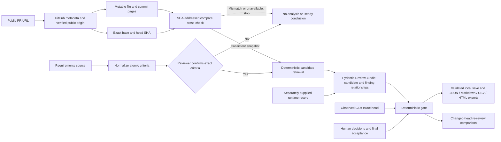

# ScopeProof evidence path — `0.2.4.dev0` integrity draft

Demonstrated core revision: `47ebc4f275b9f307c9305af3890782fa7578dff4`.
The published v0.2.3 wheel does not include these draft changes.

Candidate implementation and contract lines are E1; test candidates are E2. Neither is an
observed run. E3 is a separately recorded external runtime observation, and E4 is explicit human
acceptance. The app does not execute the target repository. GitHub pages and candidate references
must stay tied to one public PR base/head pair. Partial or inconsistent ingestion cannot yield
Ready. The core engine owns parsing, validation, retrieval, comparison, and gate logic; Streamlit
and GitHub presentation remain edge layers.

The compare API's unpaginated response has a 250-commit ceiling. This draft rejects larger
comparisons rather than producing a potentially mixed snapshot. That is an availability limit,
not successful verification.
